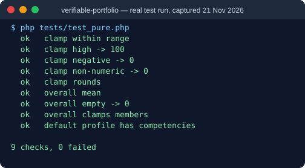

# Verifiable Portfolio (WordPress plugin) — manual

[](https://github.com/Fhionnghaile/verifiable-portfolio/actions/workflows/ci.yml) [](https://scorecard.dev/viewer/?uri=github.com/Fhionnghaile/verifiable-portfolio)

*One page, eight blocks. Every figure here comes from this repository's own tests and README.*

## 1. Claim
Renders a portfolio page (competencies, projects, certifications) from a filterable profile, with no personal data stored by the plugin.

## 2. What it is
A WordPress plugin that builds a clean, accessible portfolio page from a profile you supply through a filter, or from a built-in demo profile.

## 3. Demo
Install on a test site and visit `/portfolio`. Capture to record: the rendered page.


*Real output from this repository's own tests, captured 21 Nov 2026.*

## 4. Run it yourself
**Prerequisites:** WordPress 6.2+, PHP 7.4+.

```bash
php -l verifiable-portfolio.php
php tests/test_pure.php
# then upload to wp-content/plugins/ and activate
```

## 5. What you will see
Lint passes and the pure-function tests run. After activation, `/portfolio` renders the demo profile.

## 6. 30-second talking point
> The page is decoupled from any record system: it renders whatever the profile filter returns, so it can sit in front of a real credential store without the plugin holding personal data.

## 7. Scope and limits
- It renders data; it does not verify it. Verification belongs to the record system behind the filter (for example, Veritas).

## 8. Links
[Repository](https://github.com/fhionnghaile/verifiable-portfolio) · [readme.txt](readme.txt)
